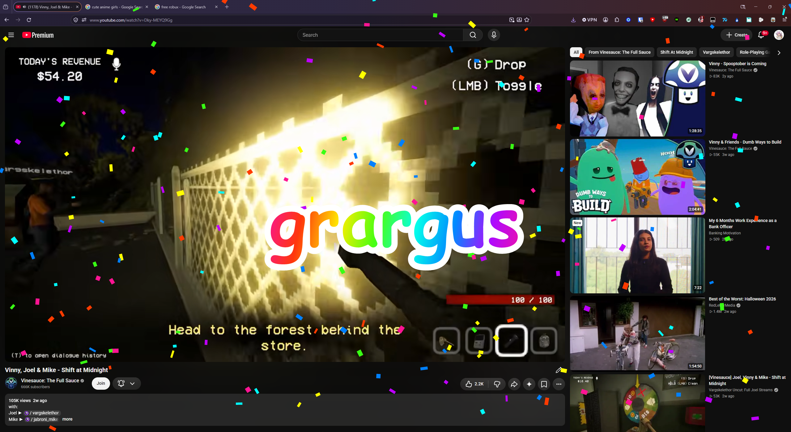

<h1 align="center">
  
  
</h1>



This program creates a nonsense word which enriches your life and your soul.

# Build Instructions:
## Windows (BlongusApp)
Build

Requires the .NET 10 SDK (net10.0-windows):

```powershell
dotnet publish c:\path\to\BlongusApp\Blongus.csproj -c Release -o c:\path\to\output
```

Output: Blongus.exe (single-file executable with embedded word lists, children_cheering.wav, and Scrimmy Bingus app.ico).

#### (Optional) 
Add `-p:SelfContained=true` if you want to run it on a Windows PC without .NET 10 installed.

### Install & Run
GUI: Double-click Blongus.exe (or run .\dist\Blongus.exe --gui).
CLI:
```powershell
.\dist\Blongus.exe --cli | Write-Output
```

System-wide CLI (optional): Copy `Blongus.exe` into any folder on your `PATH` (e.g. `%LOCALAPPDATA%\Microsoft\WindowsApps\`) for universal blongus. Use blongus in all your scripts.

## Linux / Debian (BlongusLinux, systemd & non-systemd)
Build (Cross-compile from Windows or build natively on Linux)

Requires the .NET 10 SDK and Python 3:

```powershell
dotnet publish /path/to/BlongusLinux/BlongusLinux.csproj -c Release -o /path/to/blongus/dist-linux
python /path/to/BlongusLinux/packaging/build_deb.py
```

Outputs:
Standalone self-contained ELF binary: blongus
Debian package: `blongus_0.2.1_amd64.deb`
Install & Run on Debian (and Devuan / antiX / MX / other non-systemd distros)

### Option A — Install the .deb package (sets up CLI, Scrimmy Bingus icon, and desktop launcher):

```bash
sudo apt install ./blongus_0.2.1_amd64.deb
```

*(Or `sudo dpkg -i blongus_0.2.1_amd64.deb && sudo apt-get -f install`.)*

### Option B — Standalone binary (any x86_64 Linux distro):

```bash
chmod +x blongus
sudo install -m 755 blongus /usr/local/bin/blongus
```

Usage:

`blongus --cli` — Prints a word to stdout (also automatic when piped or run headless without DISPLAY/WAYLAND_DISPLAY).
`blongus --gui` (or launch Blongus from your desktop app menu) — Shows the 5-second transparent confetti & cheering overlay.
### (Note: For audio, ensure one of pw-play / paplay / aplay / ffplay is installed.)

# Acknowledgements

Vinny Vinesauce, Jabroni Mike, and Vargskelethor Joel - No particular reason.

Scrimmy Bingus and the Crungy Spingus and Crogus Interactive

Licensed under **[The Legacy of Lunatic Kingdom No-Miss Public License (LoLK-NMPL)](LICENSE)**